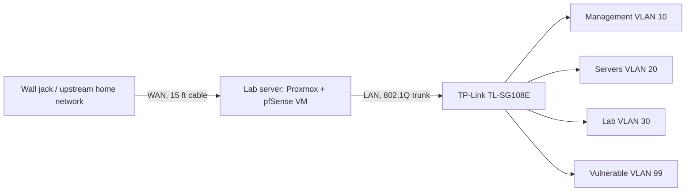

# Network Plan

## Design

The lab connects to the upstream home network through one cable. A pfSense firewall (running as a VM on Proxmox) sits between the upstream network and my lab, and the managed switch carries the lab VLANs.

## Address plan

The upstream network is a private range. The lab uses **10.10.0.0/16** so the two can never overlap.

| Network | VLAN ID | Range | Purpose |
|---|---|---|---|
| Upstream home network | none | (not documented here) | pfSense WAN side |
| Management | 10 | 10.10.10.0/24 | Proxmox, switch, pfSense admin |
| Servers | 20 | 10.10.20.0/24 | NAS and services |
| Lab | 30 | 10.10.30.0/24 | Ubuntu, Windows Server, practice VMs |
| Vulnerable | 99 | 10.10.99.0/24 | Isolated attack targets |

## Planned firewall rules (starting point)

- Management VLAN can reach everything
- Servers and Lab VLANs can reach the internet, and only specific services on each other
- Vulnerable VLAN: no route to any other VLAN, and no access to the upstream network
- Nothing from the WAN side is allowed in

## pfSense notes

- WAN sits on a private upstream network, so turn off **Block private networks** on the WAN interface, or the firewall will drop upstream traffic.
- Remote access will use Tailscale or WireGuard. No port forwarding.

## Physical port map (TL-SG108E)

| Port | Connects to | VLAN setting |
|---|---|---|
| 1 | Management PC (temporary) | Untagged VLAN 10 |
| 2 | Lab server LAN NIC | Tagged 10, 20, 30, 99 (trunk) |
| 3-8 | (assign later) | |

Update this table as the real configuration is built.

## Design decision: two NICs vs "router on a stick"

I chose a second NIC so the WAN and LAN are on separate cables, which is easier to troubleshoot. Router on a stick (one cable carrying both) is a good follow-up project.
